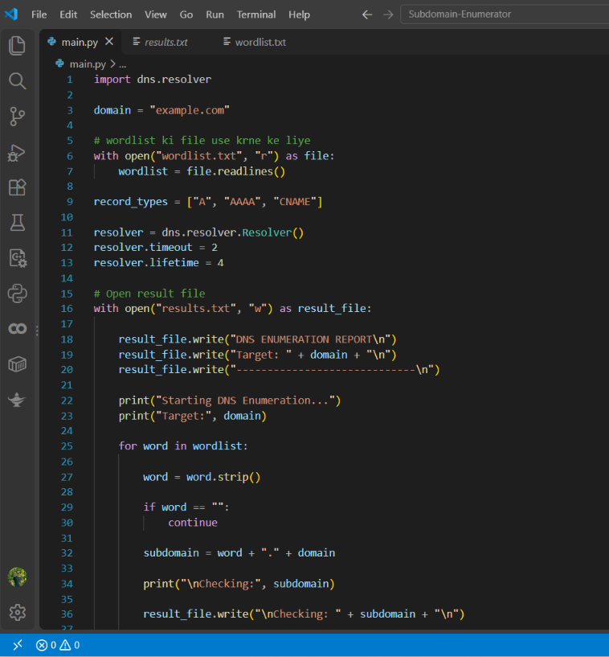
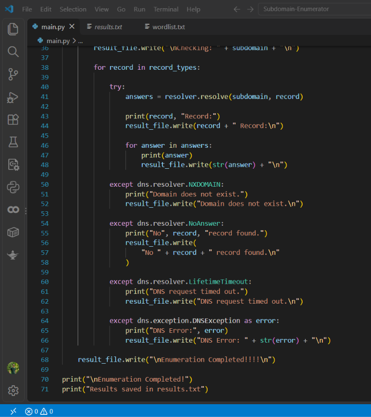
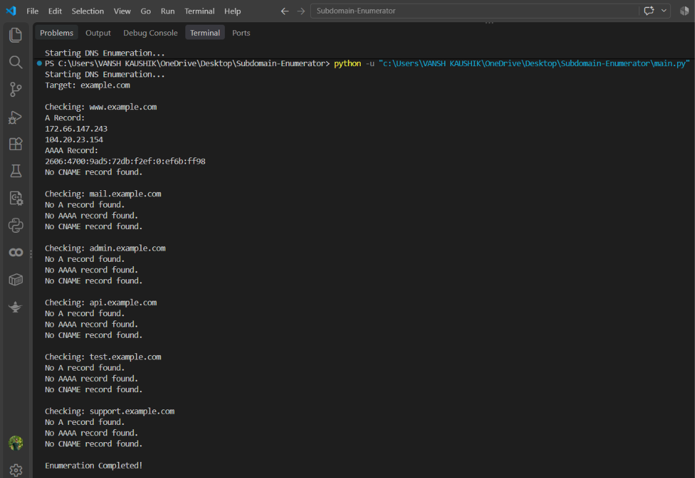
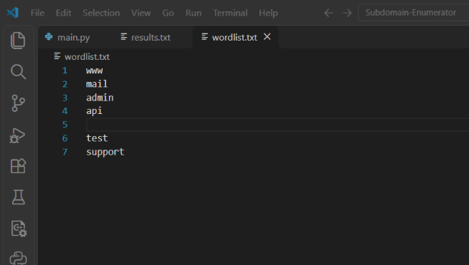
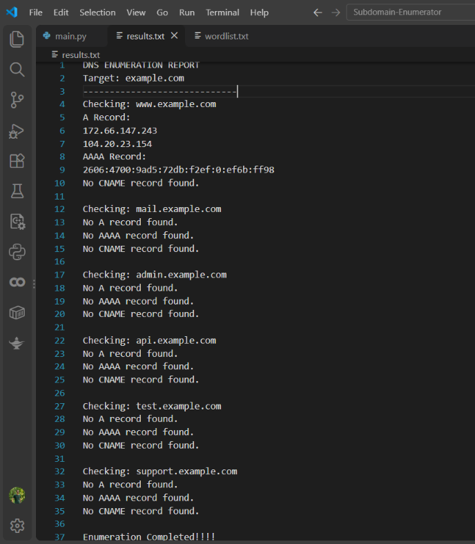

# Subdomain Enumerator 🔍

A Python-based DNS and Subdomain Enumeration Tool built using the `dnspython` library.

## 📌 About the Project

Subdomain Enumerator is a beginner-friendly cybersecurity project developed using Python. It helps identify subdomains of a given domain by performing DNS queries.

The tool uses a custom wordlist to check possible subdomains and retrieve their DNS records.

## ✨ Features

- Subdomain enumeration using a custom wordlist.
- DNS A record lookup.
- AAAA and CNAME record lookup.
- DNS resolution using Python.
- Handles DNS errors and missing records.
- Saves enumeration results in a text file.

## 🛠️ Technologies Used

- Python
- dnspython
- DNS
- VS Code
- GitHub

## 📂 Project Structure

```text
Subdomain-Enumerator/
│
├── main.py
├── learning.py
├── wordlist.txt
├── results.txt
└── screenshots/
```

## ⚙️ Installation

**1. Clone the repository**

```bash
git clone https://github.com/VanshVerse/Subdomain-Enumerator.git
```

**2. Open the project directory**

```bash
cd Subdomain-Enumerator
```

**3. Install the required library**

```bash
pip install dnspython
```

## ▶️ Usage

Run the following command:

```bash
python main.py
```

The program performs DNS queries using the configured domain and wordlist.

## 📸 Project Screenshots

Screenshots of the source code, wordlist and terminal output are available in the `screenshots` folder.

## 🎯 Learning Objectives

- Understanding DNS and subdomains.
- Learning DNS record types.
- Using Python libraries for DNS queries.
- Handling exceptions in Python.
- Understanding basic reconnaissance techniques.

## ⚠️ Disclaimer

This project is developed for educational purposes only.

Use this tool only on domains you own or have explicit permission to test. The developer is not responsible for any misuse.

## 👨‍💻 Author

**Vansh Kaushik**

- GitHub: [VanshVerse](https://github.com/VanshVerse)

---

⭐ If you find this project useful, consider giving it a star!


## 📸 Project Screenshots

### Main Python Code


### Main Code - Part 2


### Terminal Output


### Wordlist


### Results

